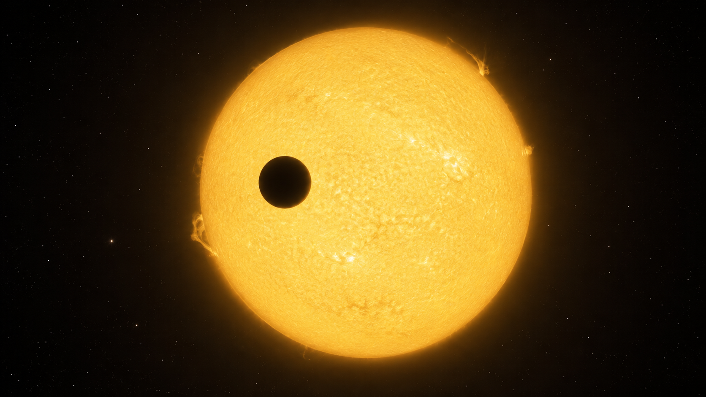

# Transit Photometry — Exoplanet Detection Method
<!-- RESEARCH-IDENTITY-START -->
**Independent research report by [Biswajit Jana](https://biswajit1999.github.io/Biswajit_Jana.github.io/)** · [Live report](https://biswajit1999.github.io/transit-photometry-detection-method/) · [ORCID](https://orcid.org/0009-0002-2411-1891) · [Complete research portfolio](https://biswajit1999.github.io/Biswajit_Jana.github.io/research/exoplanets/)
<!-- RESEARCH-IDENTITY-END -->


<p align="center">
  
</p>

<p align="center"><em>AI-generated artist's concept — not a real photograph. The quantitative figure below is generated from the explicitly declared synthetic injection.</em></p>

How the majority of known exoplanets have been found: watching a star's
brightness for the tiny, periodic dip caused by a planet passing in
front of it. This repo works through the physics and statistics of the
method and implements a Box Least Squares (BLS) period search — a
standard, widely used transit-search algorithm, related in purpose to
but not the same as the adaptive wavelet matched-filter architecture
the actual Kepler and TESS mission pipelines use — from scratch in
Python, searching period, phase, *and* duration blind, then validated
by injecting a known signal and recovering it.

**[Open the full report](https://biswajit1999.github.io/transit-photometry-detection-method/)** — the live GitHub Pages version. You can also open `index.html` locally in a browser, or serve it with `python -m http.server` from this directory.

Related, from the same author: [ExoIntel-Prime / exolight-transit-lab](https://biswajit1999.github.io/exolight-transit-lab/), an earlier transit-photometry lab covering related light-curve analysis.

## The physics

### Why the star gets dimmer, and by how much

When a planet of radius $R_p$ transits a star of radius $R_\star$, it
blocks a fraction of the starlight equal to the ratio of their disk
areas — the planet's silhouette against the star's:

$$\delta \approx \left(\frac{R_p}{R_\star}\right)^2$$

For an Earth-Sun-like pair this is about 84 parts per million; for a
Jupiter-Sun-like pair it's roughly 1%. That's the entire signal a
transit survey is trying to detect: a fractional dimming often smaller
than the star's own natural brightness fluctuations, which is why
transit searches need long, uninterrupted, high-cadence monitoring.

### How long a transit lasts

The transit duration depends on the orbital period $P$, the star's
radius, the orbital semi-major axis $a$, and the impact parameter $b$
(how centrally the planet crosses the star's disk, in units of stellar
radii — $b=0$ is a straight line through the center, $b$ near 1 is a
grazing transit):

$$T_{dur} \approx \frac{P}{\pi} \arcsin\left(\frac{R_\star}{a}\sqrt{(1+R_p/R_\star)^2 - b^2}\right)$$

For a close-in planet this is typically hours; the ratio of transit
duration to orbital period is small, which is part of why a period
search has to check many candidate periods and phases before it finds
one where a box actually lines up with real dips.

### Ingress, egress, and limb darkening

A real transit isn't a perfect box: the star dims gradually as the
planet's disk moves onto the star (ingress) and brightens gradually as
it moves off (egress), and the star itself is dimmer at its limb than
its center (limb darkening), which smooths and slightly reshapes the
dip further. Detailed transit-shape fitting (e.g. the Mandel & Agol
2002 analytic model) accounts for this; a box-shaped search like BLS
is a deliberately simpler first-pass detection tool that trades shape
accuracy for search speed, then hands promising candidates off to a
full transit-shape fit.

### Why three transits, not one

A single dip in a light curve can come from an instrumental artifact,
a starspot rotating across the disk, or a background eclipsing binary
blended into the same pixel — not just a planet. Requiring at least
three transits at a consistent period, depth, and duration is the
standard first bar for calling a signal a genuine planet candidate,
since coincidentally reproducing all three by chance gets increasingly
unlikely with each repeat.

## Why this method dominates the exoplanet census

Transit photometry needs only a stable, well-calibrated brightness
measurement — no need to resolve the star and planet separately, and no
need for the extreme spectral precision radial velocity requires. This
makes it well suited to wide-field surveys that monitor huge numbers of
stars simultaneously. Per the NASA Exoplanet Archive's confirmed-planet
counts by discovery method (accessed 2026-08-14), transit photometry
accounts for 4,676 of 6,336 confirmed exoplanets (~74%) — by a wide
margin the most productive method in the field's history, driven
almost entirely by three purpose-built space missions:

| Method | Confirmed count | Share |
|---|---|---|
| Transit | 4,676 | ~74% |
| Radial velocity | 1,197 | ~19% |
| Microlensing | 282 | ~4% |
| Direct imaging | 98 | ~2% |
| All other methods (TTV, ETV, pulsar/pulsation timing, astrometry, disk kinematics) | 83 | <2% |

Primarily via **Kepler** (2009-2018, continuous staring survey of one
~115 deg² field), **K2** (Kepler's repurposed extended mission,
2014-2018), and **TESS** (2018-present, all-sky survey).

**Limitation:** transit photometry only detects planets whose orbits
happen to be aligned edge-on as seen from Earth — a geometric
probability of roughly $R_\star/a$, meaning it systematically
undercounts real planetary systems whose orbits aren't so aligned, and
it directly measures $R_p$, not mass (radial velocity or transit-timing
follow-up is needed for that).

## What this repo's code does

`scripts/transit_photometry_demo.py`:

1. Injects a known transit signal (period, depth, duration) into a
   synthetic light curve with Kepler's own published ~100 ppm per-30-
   minute photometric noise level for a quiet Sun-like star.
2. Applies a declared 93.4%-duty-cycle timestamp window containing three
   scheduled interruptions and random missing cadences, rather than assuming
   an uninterrupted 60-day light curve.
3. Implements Box Least Squares (Kovacs, Zucker & Mazeh 2002) from
   scratch: a search over trial period, trial phase offset, *and* trial
   duration (a grid of fractional durations, not the injected value),
   sliding a box across the folded light curve at each combination and
   keeping the one with the strongest signal residue. This is a teaching
   implementation of BLS, not Kepler's production wavelet-based matched
   filter described in the Kepler Data Processing Handbook.
4. Calibrates the maximum searched signal residue with 100 noise-only
   realizations on the exact gapped timestamps and period/phase/duration grid.
   The plus-one estimate is finite-resolution and conditional on this white-
   Gaussian null model.
5. Runs randomized-epoch injections at seven depths from 25 to 850 ppm,
   with 20 trials per depth and Wilson 95% binomial intervals. A recovery
   must both clear the 99th-percentile null threshold and return a period
   within 1% of the injection.
6. Recovers the period, phase, duration, and depth, and reports the
   error against the known injected values, plus an in-transit depth
   signal-to-noise ratio.

Run it yourself:

```bash
pip install -r requirements.txt
python scripts/transit_photometry_demo.py
```

## Tests

`tests/test_transit_photometry.py` checks the transit model, deterministic
gapped cadence, Wilson-interval boundaries, and BLS search directly—not
just the illustrative run—including period recovery across multiple noise
seeds. Runs
automatically on every push via GitHub Actions; run locally with:

```bash
pytest tests/ -v
```

## Sanity check against a real target's published parameters

The depth equation at the top of this README isn't just for the
synthetic signal above — it applies directly to any real transiting
planet. Take HD 209458 b, covered elsewhere in this portfolio
(`hd209458b-exoplanet-report`): the NASA Exoplanet Archive gives its
radius as 15.58 Earth radii and its host star's radius as 1.19 Solar
radii. Plugging straight into $\delta \approx (R_p/R_\star)^2$:

```
Rp = 15.58 * 6371 km = 99,260 km
Rstar = 1.19 * 695,700 km = 827,883 km
depth = (99,260 / 827,883)^2 = 0.014375 = 14,375 ppm
```

The real JWST MIRI spectrum analyzed in that companion repo gives a
weighted-mean measured depth of 14,458 ppm — a 0.6% difference from
this two-line calculation. That's scale agreement between a bare
geometric formula and a real measured spectrum, not a validation of
the BLS search above (BLS was never run on this target here — this is
a separate, static arithmetic check). The real spectrum's own
wavelength dependence, plus limb darkening, impact parameter, and
reduction-pipeline choices (see that repo's own analysis) account for
the remaining difference.

## Result

| Quantity | Injected | Recovered | Error |
|---|---|---|---|
| Period | 4.35 days | 4.3500 days | 0.00% |
| Duration | 2.8 hours | 3.13 hours | 11.86% (searched blind over 6 fractions) |
| Depth | 850.0 ppm | 823.2 ppm | 3.15% |
| In-transit depth SNR | — | 70.8σ | descriptive; uncorrected for search trials |

The observed maximum signal residue is 0.006984, compared with a
0.0005595 99th-percentile maximum from 100 white-noise trials on the
same timestamps and search grid. None reached the observation, so the
plus-one Monte Carlo estimate is 1/101 (0.9901%). This is not a universal
or survey-wide false-alarm probability; it is a finite-resolution result
under the declared timestamp window, white-noise scale, statistic, grid,
and transit template family.

| Injected depth | Recovered trials | Recovery fraction | Wilson 95% interval |
|---:|---:|---:|---:|
| 25 ppm | 0 / 20 | 0% | 0–16.1% |
| 50 ppm | 1 / 20 | 5% | 0.9–23.6% |
| 75 ppm | 15 / 20 | 75% | 53.1–88.8% |
| 100 ppm | 20 / 20 | 100% | 83.9–100% |
| 150 ppm | 20 / 20 | 100% | 83.9–100% |
| 300 ppm | 20 / 20 | 100% | 83.9–100% |
| 850 ppm | 20 / 20 | 100% | 83.9–100% |

The randomized-epoch grid conditions on one period, duration, gapped
timestamp window, independent-Gaussian noise scale, search grid and joint
detection rule. It is not a population-level mission completeness curve.
Machine-readable results are in
[`figures/depth_recovery.csv`](figures/depth_recovery.csv).

## Limitations

The quoted depth SNR remains descriptive, not search significance. The
new maximum-statistic calibration accounts for the grid searched here,
but only under independent Gaussian noise with known scale. The timestamp
window now contains gaps, yet the simulation still omits correlated noise,
stellar variability, quarter-to-quarter systematics, crowding, transit-
timing variations and limb darkening. Duration is selected from only six
fractional templates; its 11.86% error is dominated by that declared grid.
The recovery fractions use only 20 trials per depth, hence their deliberately
wide Wilson intervals. Real Kepler/TESS candidate validation also applies
vetoes and astrophysical false-positive tests absent here.

## Extending this

Next steps are to inject correlated stellar/instrumental noise, replace
the tapered box with a limb-darkened Mandel–Agol model, randomize period,
duration and timestamp windows as well as epoch, increase Monte Carlo
resolution, and compare against `astropy.timeseries.BoxLeastSquares` and
`transitleastsquares`. The Kepler Data Processing Handbook is the appropriate
reference for the mission pipeline's wavelet whitening, gap handling,
false-alarm vetoes and statistical bootstrap.

## Why this repo uses simulated (not raw archival) data

This repo demonstrates the *method itself* — its sensitivity, biases,
and failure modes — which is best shown with a known "ground truth" to
validate recovery against. This portfolio's companion `*-exoplanet-
report` repositories instead each analyze one real target's archival
JWST/HST/Spitzer/ground-based spectra directly, with no simulated data.
Both approaches are stated plainly here rather than blurring the two.

## Repository structure

```text
scripts/transit_photometry_demo.py   BLS search, null calibration, and depth-recovery grid
figures/                             generated four-panel plot + two machine-readable CSV files
```

## References

1. Charbonneau, D. et al., 2000. Detection of Planetary Transits Across
   a Sun-like Star. *The Astrophysical Journal Letters*, 529(1), L45 —
   the first exoplanet transit detection (HD 209458 b).
2. Kovacs, G., Zucker, S. and Mazeh, T., 2002. A box-fitting algorithm in
   the search for periodic transits. *Astronomy & Astrophysics*, 391,
   pp.369-377. DOI: 10.1051/0004-6361:20020802.
3. Mandel, K. and Agol, E., 2002. Analytic Light Curves for Planetary
   Transit Searches. *The Astrophysical Journal Letters*, 580(2), L171.
4. Borucki, W.J. et al., 2010. Kepler Planet-Detection Mission:
   Introduction and First Results. *Science*, 327(5968), pp.977-980.
5. Ricker, G.R. et al., 2015. Transiting Exoplanet Survey Satellite
   (TESS). *Journal of Astronomical Telescopes, Instruments, and
   Systems*, 1(1), 014003.
6. NASA Exoplanet Archive periodogram service documentation,
   <https://exoplanetarchive.ipac.caltech.edu/docs/pgram/pgram_overview.html>
   — describes the real duration-fraction search range and false-alarm
   statistics referenced above.
7. NASA Exoplanet Archive, <https://exoplanetarchive.ipac.caltech.edu/>.
8. Jenkins, J. M. (ed.), 2020. *Kepler Data Processing Handbook*,
   KSCI-19081-003, MAST.

## Author

Biswajit Jana — [Portfolio](https://biswajit1999.github.io/Biswajit_Jana.github.io/) · [GitHub](https://github.com/Biswajit1999) · [LinkedIn](https://www.linkedin.com/in/biswajit-jana-27011a151/) · [ORCID](https://orcid.org/0009-0002-2411-1891)
